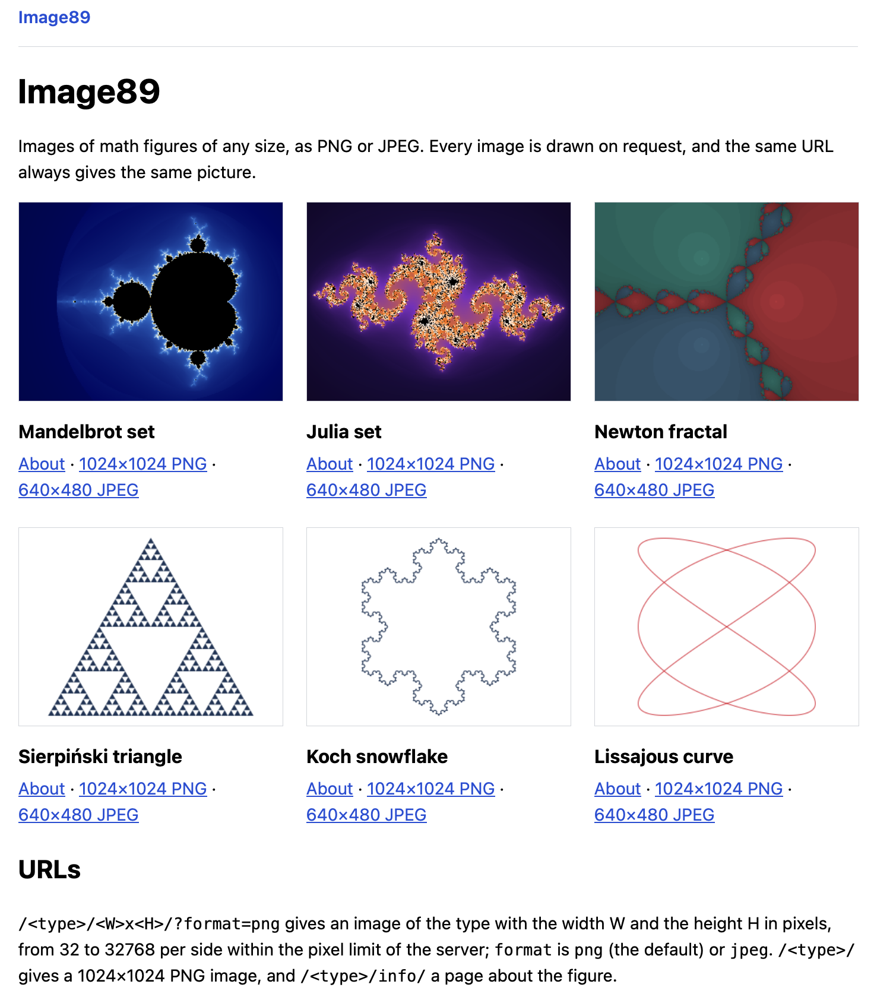
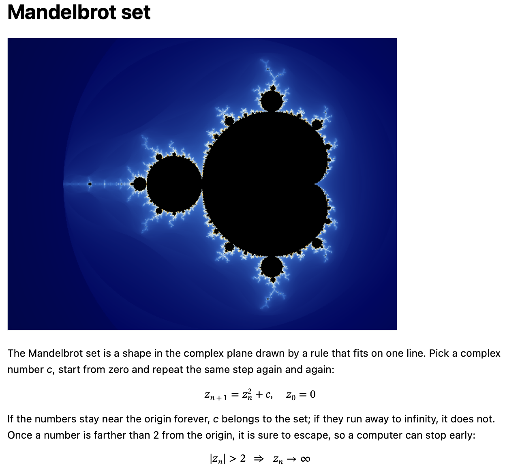
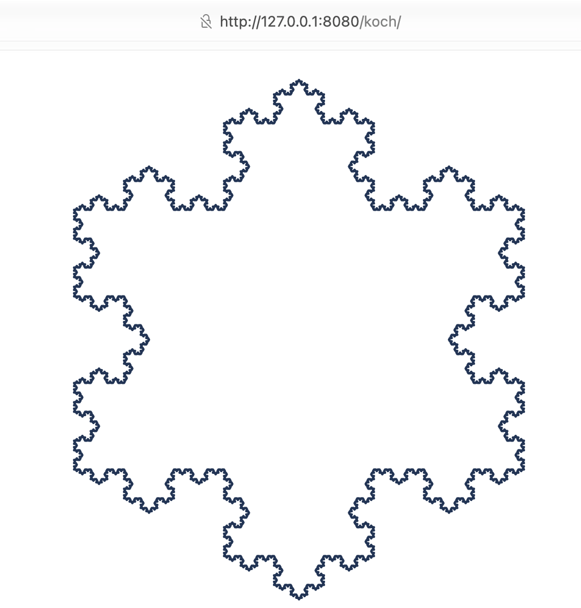

# Image89


Image89 makes images of math figures: the Mandelbrot set, the Julia set, the Newton fractal,
the Sierpiński triangle, the Koch snowflake and a Lissajous curve. One binary has two modes.
In CLI mode, it writes an image to a file. In server mode, it sends images over HTTP and shows
a page about each figure.



## Features

- Six figures: three pixel fractals and three geometric figures.
- PNG or JPEG output.
- Each side of an image is from 32 to 32768 pixels. By default, an image has at most
  16 777 216 pixels (4096 × 4096).
- For one version and one config, the same URL always gives the same image. Caches can keep it.
- A page with the history and the formulas of each figure.
- Server limits: concurrent images, a queue and a timeout for each image.
- Graceful shutdown on SIGINT and SIGTERM.
- An optional TOML config. Without it, the built-in defaults apply.
- A Docker image for linux/amd64 and linux/arm64.

## Install

Build from source with Go 1.27:

```sh
git clone https://github.com/z0rr0/image89.git
cd image89
make build      # writes ./image89 with the version from git
```

Or get the Docker image from Docker Hub:

```sh
docker pull z0rr0/image89
```

## Quick start

```sh
./image89 -t julia -w 1920 -h 1080 -o julia      # writes julia.png
./image89 -s                                     # open http://localhost:8080/
docker run --rm -p 8080:8080 z0rr0/image89      # the server in Docker
```

## How it works

Image89 draws each image on request and does not store it. For each image request, the server:

1. Checks the type, the size and the format.
2. Waits for a free generation slot. If the queue is full or the wait is too long, it returns `503`.
3. Draws the figure. By default, it uses all CPU cores.
4. Encodes the image to PNG or JPEG and sends it to the client.

The CLI uses the same steps and limits, but it writes the image to a file.

## Figures

| Type         | Figure                                         | How Image89 draws it                                                         |
|--------------|------------------------------------------------|------------------------------------------------------------------------------|
| `mandelbrot` | Mandelbrot set                                 | Each pixel is a point of the complex plane. The color shows its escape time. |
| `julia`      | Julia set of z² + c                            | The same, but the preset sets `c`. The pixel is the start value.             |
| `newton`     | Newton fractal of zⁿ − 1                       | The color shows the root that Newton's method reaches from the pixel.        |
| `sierpinski` | Sierpiński triangle                            | 3^d filled triangles, where d is the depth.                                  |
| `koch`       | Koch snowflake                                 | A closed line of 3·4^d segments.                                             |
| `lissajous`  | Lissajous curve x = sin(a·t + δ), y = sin(b·t) | A closed line through points of the curve.                                   |

For the pixel fractals, Image89 calculates the color of each pixel. The other three figures are polygons.
Image89 fits them into the image and draws them with anti-aliasing. Small images show fewer levels of detail.
[docs/figures.md](docs/figures.md) has the details.

Each figure has a page at `/<type>/info/` with its history and formulas:



## CLI

```sh
./image89                                          # writes output.png: mandelbrot, 1024×1024
./image89 -w 640 -h 480 -t julia -f jpeg -o pic   # writes pic.jpg
./image89 -w 1920 -h 1080 -o wall.png             # the name has an extension, so it stays
./image89 -v                                       # prints the version
./image89 -help                                    # prints the usage
```

| Flag | Description                                                                               |
|------|-------------------------------------------------------------------------------------------|
| `-w` | image width, from 32 to 32768 (default 1024)                                              |
| `-h` | image height, from 32 to 32768 (default 1024)                                             |
| `-t` | figure type: `mandelbrot` (default), `julia`, `newton`, `sierpinski`, `koch`, `lissajous` |
| `-o` | output file (default `output.<ext>`)                                                      |
| `-f` | output format: `png` (default) or `jpeg`                                                  |
| `-c` | path to a TOML config (optional)                                                          |
| `-s` | run the web server                                                                        |
| `-v` | print the version and exit                                                                |

Important rules:

- `-h` sets the image height. To see the usage, use `-help`.
- Image89 never overwrites a file. If the output file exists, the run fails.
- Image89 adds the extension (`.png` or `.jpg`) only if the name has no extension.
  For example, `-o pic.png -f jpeg` writes a JPEG image into `pic.png`.
- By default, an image has at most 16 777 216 pixels, so `-w 8192 -h 8192` fails.

For larger images, set higher limits in a config and pass it with `-c`. The CLI checks
the full config too, so `server.write_timeout` must be more than `limits.queue_timeout + limits.timeout`:

```toml
[server]
write_timeout = "130s"

[limits]
max_pixels = 67108864 # 8192 × 8192
timeout = "120s"
```

[docs/usage.md](docs/usage.md#cli) has all CLI rules, the log record and the exit codes.

## Web server

```sh
./image89 -s                       # listen on :8080 with the built-in defaults
./image89 -s -c config.toml        # use the address, timeouts, limits and presets of a config
curl -o pic.jpg 'http://localhost:8080/julia/640x480/?format=jpeg'
```

| Request                                   | Response                            |
|-------------------------------------------|-------------------------------------|
| `GET /`                                   | index page with all figures         |
| `GET /<type>/<W>x<H>/?format=<png\|jpeg>` | image of W×H pixels, PNG by default |
| `GET /<type>/`                            | image of 1024×1024 pixels           |
| `GET /<type>/info/`                       | page about the figure               |
| `GET /health`                             | `200 OK` for health checks          |
| `GET /version`                            | application version                 |

The server returns `400` for an invalid size or format and `503` when it is busy.
[docs/usage.md](docs/usage.md#http-api) lists all status codes, headers and log records.

A request to `/koch/` in a browser:



### Use a reverse proxy

Run the server behind a reverse proxy that buffers responses. A generation slot stays busy until
the server sends the whole image. A slow client can hold a slot for up to `server.write_timeout` (30s).
If slow clients occupy all generation slots, other image requests can get `503`.
nginx buffers responses by default (`proxy_buffering on`). Keep this setting.

[docs/nginx.conf](docs/nginx.conf) is a full nginx example with TLS, buffering, an image cache and
limits for each client. [docs/deployment.md](docs/deployment.md) explains the limits, the proxy setup
and the memory use.

## Docker

The Docker image `z0rr0/image89` is on Docker Hub for linux/amd64 and linux/arm64.
By default, it starts the web server (`-s`) on port 8080.

```sh
docker run --rm -p 8080:8080 z0rr0/image89     # the web server
docker run --rm z0rr0/image89 -v               # print the version
```

[docker-compose.yml](docker-compose.yml) runs the server with `./config.toml` and a health check at `/health`:

```sh
cp docs/config.toml config.toml
docker compose up -d
```

Create `./config.toml` before `docker compose up`. If the file does not exist, Docker creates
a directory with this name.

The compose file sets `stop_grace_period: 15s`. This is more than `server.shutdown_timeout` (10s),
so active requests can finish before Docker stops the container. If you increase `shutdown_timeout`,
increase `stop_grace_period` too. [docs/deployment.md](docs/deployment.md#docker) has the details.

Build the image yourself:

```sh
make docker        # build z0rr0/image89 for the host architecture
make docker-push   # build linux/amd64 and linux/arm64 images and push them, needs a git tag
```

## Configuration

Both modes work without a config file. Without `-c`, Image89 reads no config file.
`-c config.toml` loads a TOML file over the built-in defaults.
The file contains only the values that you change. Unknown keys and invalid values cause an error.
[docs/config.toml](docs/config.toml) shows all keys with their default values and comments.

| Section          | Contents                                                                                                           |
|------------------|--------------------------------------------------------------------------------------------------------------------|
| `[server]`       | `addr`, `debug`, HTTP timeouts, `shutdown_timeout`, `cache_max_age` of images and pages                            |
| `[limits]`       | `max_pixels`, `max_concurrent`, `max_queued`, `queue_timeout`, `timeout`, `workers`, `max_iterations`, `max_depth` |
| `[types.<type>]` | preset of each figure: iterations or depth, visible area, colors, line width, padding                              |

Rules for values:

- Durations are Go duration strings, for example `"10s"` or `"1m30s"`.
- `server.read_header_timeout` must not be more than `server.read_timeout`.
- `server.write_timeout` must be more than `limits.queue_timeout + limits.timeout`.

Each concurrent image needs memory. In the load tests with the default limits, the peak RSS was 0.42–0.51 GB.
[docs/deployment.md](docs/deployment.md#memory) has the formula and tells how to decrease it.

## Development

You need Go 1.27 and [golangci-lint](https://golangci-lint.run/) v2. The code uses the standard library,
[go-toml](https://github.com/pelletier/go-toml) for the config and
[golang.org/x/image/vector](https://pkg.go.dev/golang.org/x/image/vector) to draw the geometric figures.

```sh
make build   # build ./image89 with the version from git
make test    # run linters, govulncheck and tests with -race
make bench   # run benchmarks; BENCH=<regexp> selects them, BENCHFLAGS adds flags such as -count=10
make fuzz    # fuzz the parsers of client input, FUZZTIME (30s) for each target
make dist    # cross-compile binaries into dist/
make run     # build and start the server with docs/config.toml
make clean   # remove the binary and dist/
go run ./cmd/loadtest -c 4 -n 20 -path /mandelbrot/   # load a running server; -help lists the flags
```

`make test` also runs the seed corpus of the fuzz targets. If `make fuzz` finds a failing input,
it saves the input in `testdata/fuzz/<target>/`. Commit this file together with the fix.

[docs/benchmarks.md](docs/benchmarks.md) has the measurements behind the default limits and the internal
constants, and the commands to repeat them. [AGENTS.md](AGENTS.md) describes the packages and the code conventions.

## License

Image89 uses the [MIT License](https://opensource.org/license/MIT).
The full text is in the [LICENSE](LICENSE) file.
